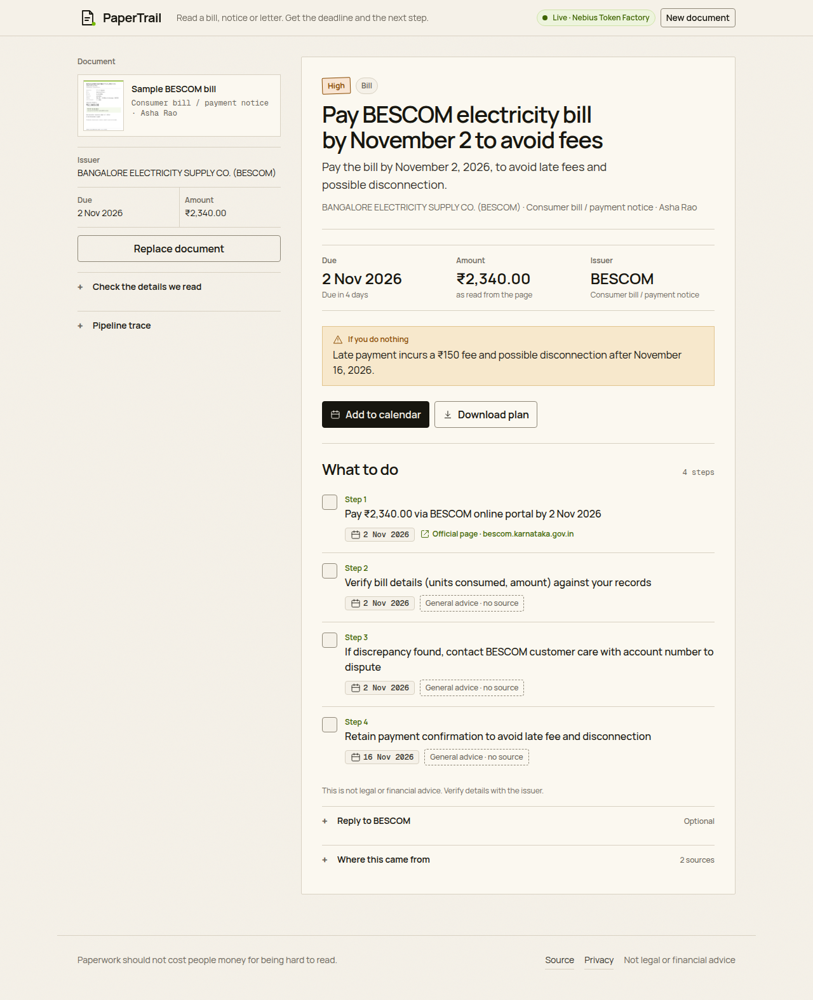
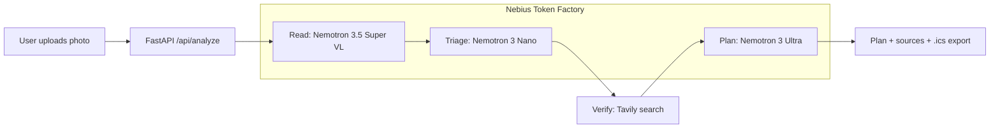

# PaperTrail

Read a bill, notice or letter. Get the deadline and the next step.

**Live demo:** <https://papertrail-6apc.onrender.com>

**Demo video:** <https://youtu.be/m9uk869VvDs>



PaperTrail is a result-first document agent. You add a photo of a bill, tax
notice, rent agreement, bank letter, government form or medical bill. It reads
the page, checks official guidance, and returns the deadline, an ordered action
plan, the pages behind each step, and a reply you can send.

## The problem

Important deadlines hide inside dense paperwork. A utility bill, a tax notice or
a government form buries the one date that matters under language written for
administrators, not for the person receiving it. Missing that date costs late
fees, penalties or service.

Scanning a document is a solved problem. Knowing what to do with it is not.

## How it works

1. **Read** — NVIDIA Nemotron 3.5 Super VL reads the photo into structured facts:
   issuer, document type, amounts, reference numbers, key dates, requested
   actions and a short excerpt.
2. **Triage** — NVIDIA Nemotron 3 Nano assigns a category and urgency and writes
   a one-sentence plain-language summary.
3. **Verify** — Tavily searches for guidance on how to act on this document. The
   issuer's own portal is queried directly, social and aggregator domains are
   removed, and sources must mention the issuer before they reach the planner.
4. **Plan** — NVIDIA Nemotron 3 Ultra writes a deadline-ordered plan. Steps that
   depend on a procedure, fee or portal must cite a URL from the verified source
   list; invented URLs are stripped server-side and unsupported steps are marked
   **General advice · no source**.
5. **Export** — deadlines download as an `.ics` calendar file; the plan downloads
   as Markdown.

The UI shows a real pipeline trace with each model, its latency and token usage.

## Model routing

Every call goes through the **Nebius Token Factory** OpenAI-compatible API. One
client, four model IDs, routed by the job.

| Stage | Model ID | Why this model |
|---|---|---|
| Read (vision) | `nvidia/Nemotron-3.5-Super-VL` | Transcribes the page and returns structured facts from the image. |
| Triage (fast) | `nvidia/NVIDIA-Nemotron-3-Nano-30B-A3B` | Category, urgency and a one-line summary are latency-sensitive, so they run on the fast model. |
| Plan (reasoning) | `nvidia/Nemotron-3-Ultra-550b-a55b` | The grounded plan needs the strongest reasoning over the document and the web sources. |
| Fallback | `nvidia/nemotron-3-super-120b-a12b` | If vision or reasoning fails, the Super model retries once and the trace is marked degraded. |

A live run on the sample bill takes roughly 15 seconds end to end and cites the
official BESCOM portal.

### Reasoning-first defaults

Nemotron 3.5 Super-VL and Nemotron 3 Nano are reasoning-first on the live
endpoint. With their default settings, hidden thinking consumed the entire token
budget and the stages returned empty content. PaperTrail sends
`chat_template_kwargs: {"enable_thinking": false}` for vision and triage only;
Nemotron 3 Ultra keeps full reasoning for the plan.

## Architecture



## Product design

- **Result first.** The case file sits beside the intake rail; the result starts
  near the top of the page instead of below a marketing hero. On mobile the page
  scrolls to the result and focuses its heading.
- **Decision header.** Due date, amount and issuer are the first facts after the
  headline. The calendar action stays visible on mobile.
- **Honest sources.** A step says **Official page**, **Issuer page**,
  **Source page**, **Demo page** or **General advice · no source**. The app never
  puts a check mark on a URL that did not support the step.
- **Progressive detail.** Facts, pipeline trace, draft reply and source list are
  disclosures, so the answer stays readable.
- **Demo mode.** With no keys, the app runs on canned data and labels it
  **Demo data**; it never presents mock latency as real.

## Stack

- Python 3.11+, FastAPI, Uvicorn
- NVIDIA Nemotron via Nebius Token Factory
- Tavily for web grounding
- Vanilla HTML, CSS and JavaScript; no frontend build step
- Pillow for image preprocessing
- Hand-written RFC 5545 `.ics` generation

## Run locally

```bash
git clone https://github.com/bhanu-dev82/papertrail
cd papertrail
python -m venv .venv
source .venv/bin/activate          # Windows: .venv\Scripts\activate
pip install -r requirements.txt
cp .env.example .env               # add keys, or set MOCK_MODE=true
uvicorn app.main:app --reload
```

Open <http://localhost:8000> and click **Try sample bill**.

### Environment

| Variable | Purpose |
|---|---|
| `MOCK_MODE` | `true` runs the whole pipeline on canned demo data with no API keys. |
| `NEBIUS_API_KEY` | Token Factory key. If empty, the app runs in demo mode. |
| `TAVILY_API_KEY` | Tavily key. If empty, only verification uses demo sources, tagged as demo pages. |
| `NEBIUS_BASE_URL_VISION` / `_FAST` / `_REASON` | Per-role base URLs for regional model availability. |
| `MODEL_VISION` / `_FAST` / `_REASON` / `_FALLBACK` | Model IDs. |
| `REQUEST_TIMEOUT_SECONDS` | Per-request timeout, default 90. |

## API

| Method | Path | Purpose |
|---|---|---|
| POST | `/api/analyze` | Upload an image and run the full pipeline. |
| POST | `/api/analyze-sample` | Run the bundled sample bill. |
| GET | `/api/health` | Mode, model IDs and Tavily status. |
| GET | `/api/results/{id}/calendar.ics` | Download deadlines as a calendar file. |
| GET | `/api/results/{id}/plan.md` | Download the plan as Markdown. |

## Tests

```bash
pytest -q
python -m compileall app
```

The suite covers JSON extraction from reasoning-model output, source ranking,
`.ics` and Markdown export, API errors and the demo-mode path.

## Privacy

Images are processed in memory only. They are not written to disk and not kept
after the response. Results stay in memory for the last 20 documents so the
download links work, and disappear when the process restarts. The only outbound
calls are to Nebius Token Factory and Tavily.

## Limitations

- Single-page images only; PDFs are not parsed.
- English-first extraction and generated plans.
- Not legal, tax or financial advice. Check the amount and date with the issuer.

## Future work

- Native capture inside **Keepary**, the Android OCR scanner from the same
  builder.
- Multi-page PDF support.
- Scheduled reminders with Nebius Serverless Jobs.
- Hindi and Kannada output.

## Feedback on Nebius Token Factory and NVIDIA models

Written from building this project, not from a benchmark:

- **The OpenAI-compatible surface is the best part.** Three models with different
  jobs, one client, no rewrite between stages. Swapping from Nano to Ultra is a
  string change.
- **Regional model availability is the sharp edge.** The catalog lists models per
  region, and it is not obvious whether the global base URL reaches every model.
  Per-role base URLs and a clear 404 message that names the environment variable
  to change would save every new team an afternoon.
- **Reasoning-first defaults silently break fixed budgets.** Super-VL and Nano
  returned empty content with `finish_reason="length"` until we passed
  `enable_thinking=false`. Document this on the model page with a copy-paste
  example; it is invisible unless you inspect `finish_reason`.
- **A JSON mode or schema hint would help reasoning models.** Ultra can wrap
  output in `<think>` blocks or prose. PaperTrail strips them and retries, but a
  first-class structured-output option would remove that reliability tax.
- **Vision payload format.** State clearly whether the VL endpoint accepts base64
  data URLs and what the size limits are. PaperTrail downscales to 1600 px and
  re-encodes JPEG q85 defensively.
- **Tavily pairing is natural.** Grounding the planner in live search results is
  the difference between a plausible plan and a plan someone can act on.

## License

MIT — see [LICENSE](LICENSE). Copyright 2026 Bhanu (Devanshu Studios).
